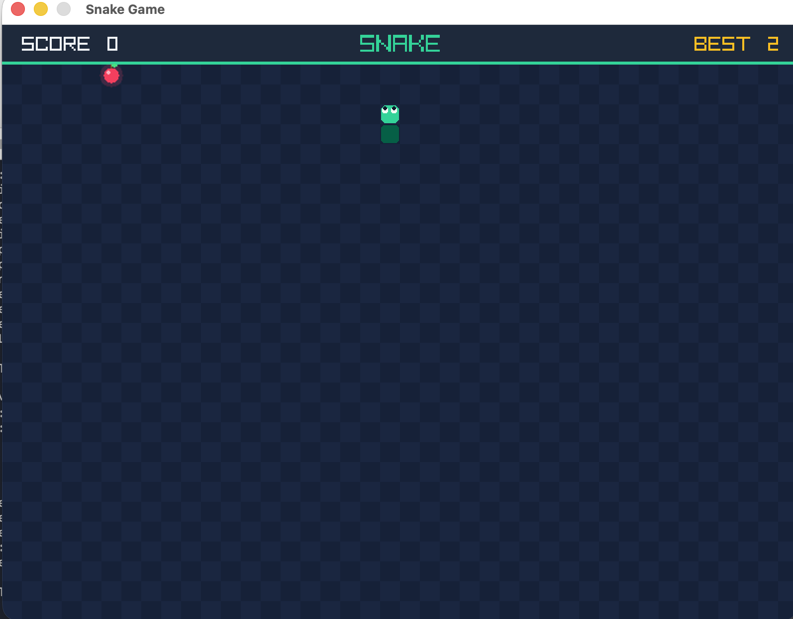
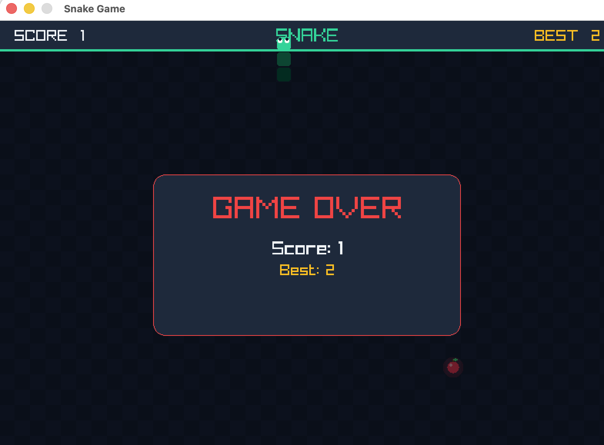

# Snake Game in C
A classic Snake game written in C using [raylib](https://www.raylib.com/).

  
  

## Features
- Classic snake movement and growth
- Food spawning at random positions
- Score counter
- High score saved between games (`highscore.txt`, created automatically)

## Controls
- Arrow keys : Move the snake

## How to build and run

### Requirements
- A C compiler (gcc or clang)
- raylib (on macOS: `brew install raylib`)

## Credits
Built while learning C, using:
- [Beej's Guide to C Programming](https://beej.us/guide/bgc/) by Brian "Beej Jorgensen" Hall
- Various YouTube tutorials
- AI assistance for explanations and debugging

## License
This project is licensed under the MIT License. See [LICENSE](LICENSE) for details.
